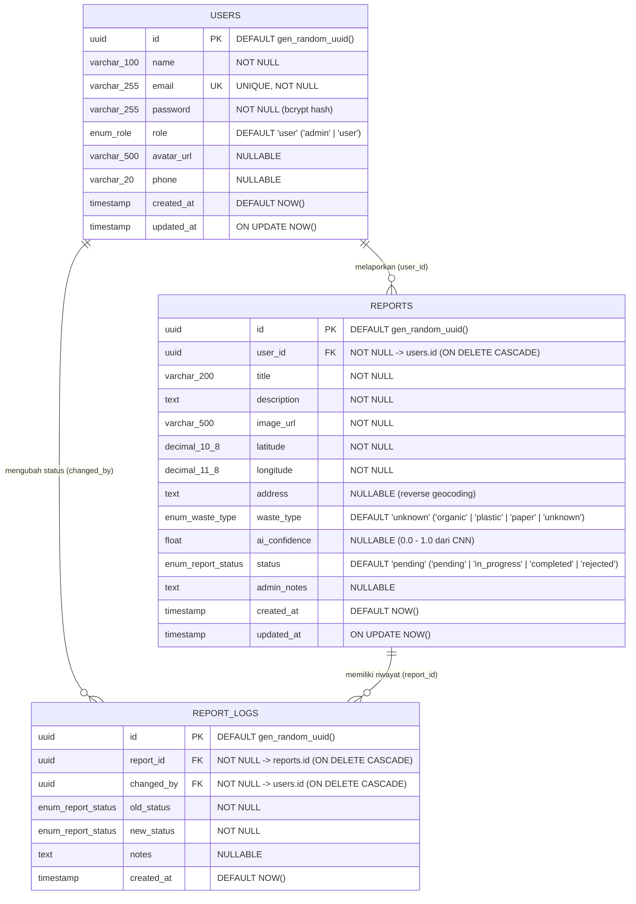

# Database Design & Entity-Relationship Diagram (ERD)
## Smart Waste Management System

Dokumen ini menjelaskan rancangan skema basis data relasional **PostgreSQL (Neon Serverless)** yang dikelola menggunakan **Prisma ORM** ([`backend/src/prisma/schema.prisma`](../backend/src/prisma/schema.prisma)).

---

## 1. Diagram Entity-Relationship (Mermaid ERD)



---

## 2. Diagram Relasi Tekstual (ASCII)

```text
+-----------------------------------+          +----------------------------------------+
|               users               |          |                reports                 |
+-----------------------------------+          +----------------------------------------+
| PK  id          UUID              |1        *| PK  id             UUID                |
|     name        VARCHAR(100)      |----------| FK  user_id        UUID (users.id)     |
| UK  email       VARCHAR(255)      |          |     title          VARCHAR(200)        |
|     password    VARCHAR(255)      |          |     description    TEXT                |
|     role        Role ('user')     |          |     image_url      VARCHAR(500)        |
|     avatar_url  VARCHAR(500)?     |          |     latitude       DECIMAL(10,8)       |
|     phone       VARCHAR(20)?      |          |     longitude      DECIMAL(11,8)       |
|     created_at  TIMESTAMP         |          |     address        TEXT?               |
|     updated_at  TIMESTAMP         |          |     waste_type     WasteType           |
+-----------------------------------+          |     ai_confidence  DOUBLE PRECISION?   |
                  |1                           |     status         ReportStatus        |
                  |                            |     admin_notes    TEXT?               |
                  |                            |     created_at     TIMESTAMP           |
                  |                            |     updated_at     TIMESTAMP           |
                  |                            +----------------------------------------+
                  |                                                |1
                  |                                                |
                  |            +-----------------------------------+
                  |            |
                  |*           |*
         +-----------------------------------+
         |            report_logs            |
         +-----------------------------------+
         | PK  id          UUID              |
         | FK  report_id   UUID (reports.id) |
         | FK  changed_by  UUID (users.id)   |
         |     old_status  ReportStatus      |
         |     new_status  ReportStatus      |
         |     notes       TEXT?             |
         |     created_at  TIMESTAMP         |
         +-----------------------------------+
```

---

## 3. Definisi Tipe Data ENUM

| Nama ENUM | Nilai yang Diizinkan | Nilai Default | Deskripsi |
| :--- | :--- | :---: | :--- |
| **`Role`** | `'admin'`, `'user'` | `'user'` | Hak akses pengguna untuk pemisahan RBAC antara petugas Dinas Lingkungan Hidup (`admin`) dan warga pelapor (`user`). |
| **`WasteType`** | `'organic'`, `'plastic'`, `'paper'`, `'unknown'` | `'unknown'` | Kategori jenis sampah hasil klasifikasi model CNN MobileNetV2 (`organic`, `plastic`, `paper`) atau manual. |
| **`ReportStatus`** | `'pending'`, `'in_progress'`, `'completed'`, `'rejected'` | `'pending'` | Siklus hidup penanganan laporan sampah dari antrean awal hingga verifikasi selesai/ditolak. |

---

## 4. Spesifikasi Detail Tabel

### 4.1. Tabel `users`
Menyimpan kredensial autentikasi, profil identitas, serta peran (*role*) pengguna.

| Kolom | Tipe PostgreSQL | Constraint | Keterangan |
| :--- | :--- | :--- | :--- |
| `id` | `UUID` | `PRIMARY KEY`, `DEFAULT gen_random_uuid()` | Pengenal unik pengguna (UUID v4). |
| `name` | `VARCHAR(100)` | `NOT NULL` | Nama lengkap warga atau petugas admin. |
| `email` | `VARCHAR(255)` | `UNIQUE`, `NOT NULL` | Alamat email unik untuk login. |
| `password` | `VARCHAR(255)` | `NOT NULL` | Hash password menggunakan algoritma `bcrypt` (10 salt rounds). |
| `role` | `"Role"` | `NOT NULL`, `DEFAULT 'user'` | Peran otorisasi (`admin` atau `user`). |
| `avatar_url` | `VARCHAR(500)` | `NULL` | URL foto profil pengguna (opsional). |
| `phone` | `VARCHAR(20)` | `NULL` | Nomor telepon/WhatsApp aktif pelapor. |
| `created_at` | `TIMESTAMP(3)` | `NOT NULL`, `DEFAULT CURRENT_TIMESTAMP` | Waktu pembuatan akun. |
| `updated_at` | `TIMESTAMP(3)` | `NOT NULL` | Waktu pembaruan profil terakhir. |

### 4.2. Tabel `reports`
Menyimpan data laporan timbulan sampah lengkap dengan koordinat GPS, URL foto, hasil klasifikasi AI CNN, serta status tindak lanjut.

| Kolom | Tipe PostgreSQL | Constraint | Keterangan |
| :--- | :--- | :--- | :--- |
| `id` | `UUID` | `PRIMARY KEY`, `DEFAULT gen_random_uuid()` | Pengenal unik laporan sampah. |
| `user_id` | `UUID` | `FOREIGN KEY -> users(id) ON DELETE CASCADE` | Pelapor yang mengirimkan laporan. |
| `title` | `VARCHAR(200)` | `NOT NULL` | Judul singkat laporan temuan sampah. |
| `description` | `TEXT` | `NOT NULL` | Deskripsi detail kondisi lapangan & volume sampah. |
| `image_url` | `VARCHAR(500)` | `NOT NULL` | Path/URL foto bukti lapangan (`/uploads/...`). |
| `latitude` | `DECIMAL(10,8)` | `NOT NULL` | Koordinat garis lintang lokasi sampah. |
| `longitude` | `DECIMAL(11,8)` | `NOT NULL` | Koordinat garis bujur lokasi sampah. |
| `address` | `TEXT` | `NULL` | Alamat jalan hasil *reverse geocoding* OpenStreetMap Nominatim. |
| `waste_type` | `"WasteType"` | `NOT NULL`, `DEFAULT 'unknown'` | Kategori sampah (`organic`, `plastic`, `paper`, `unknown`). |
| `ai_confidence` | `DOUBLE PRECISION` | `NULL` | Skor probabilitas tertinggi dari model CNN (`0.0` – `1.0`). |
| `status` | `"ReportStatus"` | `NOT NULL`, `DEFAULT 'pending'` | Status penanganan laporan saat ini. |
| `admin_notes` | `TEXT` | `NULL` | Catatan resmi dari petugas admin saat memperbarui status. |
| `created_at` | `TIMESTAMP(3)` | `NOT NULL`, `DEFAULT CURRENT_TIMESTAMP` | Waktu laporan dikirim. |
| `updated_at` | `TIMESTAMP(3)` | `NOT NULL` | Waktu perubahan terakhir pada laporan. |

### 4.3. Tabel `report_logs`
Menyimpan jejak audit (*audit trail*) setiap kali status laporan berubah untuk ditampilkan pada linimasa pelacakan warga dan admin.

| Kolom | Tipe PostgreSQL | Constraint | Keterangan |
| :--- | :--- | :--- | :--- |
| `id` | `UUID` | `PRIMARY KEY`, `DEFAULT gen_random_uuid()` | Pengenal unik entri log perubahan status. |
| `report_id` | `UUID` | `FOREIGN KEY -> reports(id) ON DELETE CASCADE` | Referensi ke laporan sampah yang diubah. |
| `changed_by` | `UUID` | `FOREIGN KEY -> users(id) ON DELETE CASCADE` | Petugas/pengguna yang melakukan perubahan status. |
| `old_status` | `"ReportStatus"` | `NOT NULL` | Status laporan sebelum perubahan. |
| `new_status` | `"ReportStatus"` | `NOT NULL` | Status laporan setelah perubahan. |
| `notes` | `TEXT` | `NULL` | Catatan tindakan lapangan pada perubahan status tersebut. |
| `created_at` | `TIMESTAMP(3)` | `NOT NULL`, `DEFAULT CURRENT_TIMESTAMP` | Waktu terjadinya transisi status. |

---

## 5. Indeks Performa Query (`INDEX`)

Untuk memastikan performa filter, pencarian, dan agregasi dashboard tetap cepat, skema menerapkan indeks berikut:
1. `users_email_key` (`UNIQUE` pada `users.email`) — Pencarian cepat saat login dan validasi registrasi.
2. `reports_user_id_idx` (`reports.user_id`) — Mengoptimalkan query riwayat laporan milik pengguna (`GET /api/reports/my` & `GET /api/stats/my`).
3. `reports_status_idx` (`reports.status`) — Mengoptimalkan filter berdasarkan status (`pending`, `in_progress`, `completed`, `rejected`) dan agregasi `GROUP BY status`.
4. `reports_waste_type_idx` (`reports.waste_type`) — Mengoptimalkan filter kategori sampah dan agregasi `GROUP BY waste_type`.
5. `reports_created_at_idx` (`reports.created_at`) — Mengoptimalkan pengurutan laporan terbaru (`ORDER BY created_at DESC`) dan filter rentang tanggal.
6. `report_logs_report_id_idx` (`report_logs.report_id`) — Mengoptimalkan pembacaan linimasa riwayat status per laporan.
